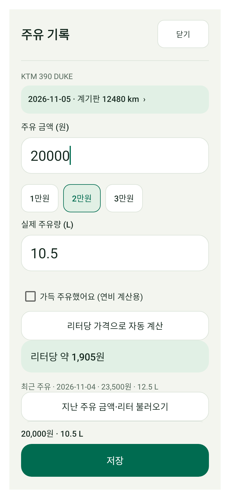
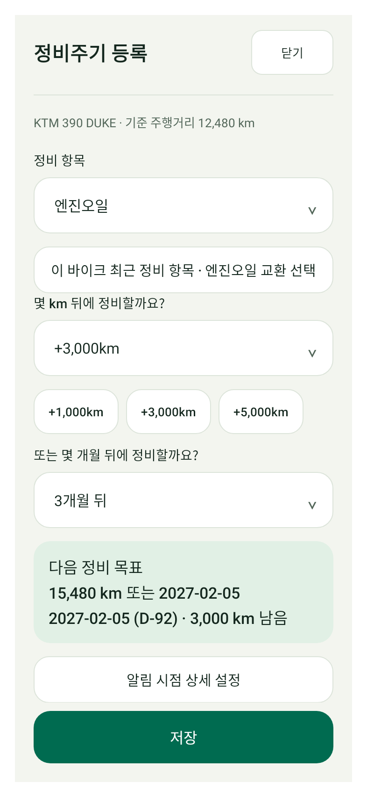
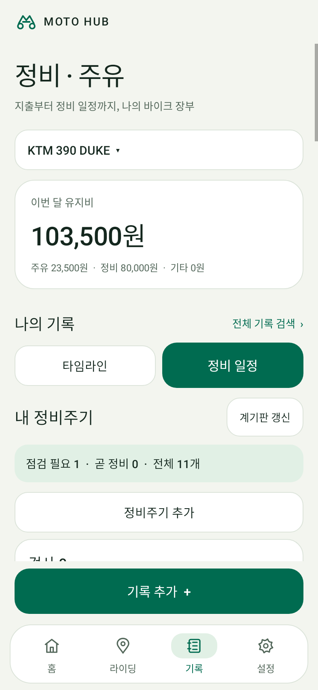
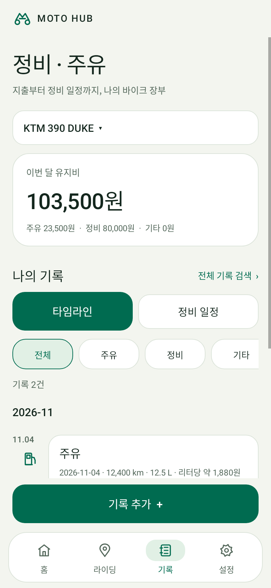
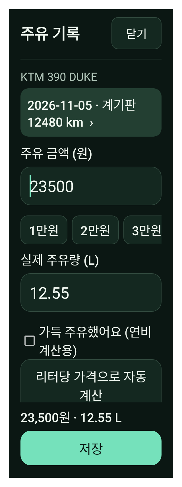
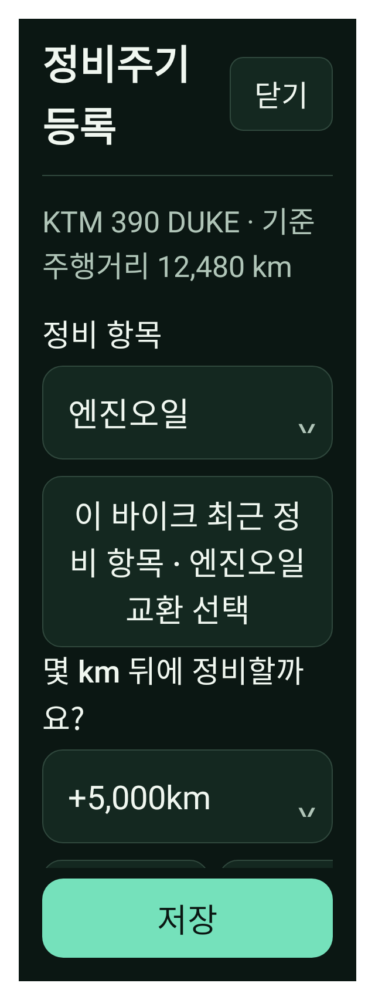

# MOTO HUB 정비·주유 편의성 개선

- **정비주기:** 빠른 거리 선택과 실시간 목표 km·날짜 미리보기. 최근 정비 항목, 같은 바이크/항목의 이전 주기 불러오기, 카드에서 바로 주기 조정.
- **정비 상태:** 점검 필요·곧 정비·전체 개수, 큰 남은 거리, 목표 거리와 예정일. 8개 이후 항목도 더 보기로 확인할 수 있습니다.
- **주유:** 1만/2만/3만원 빠른 선택, 바로 보이는 지난 기록 불러오기, 날짜·계기판 확인, 리터당 가격과 고정 저장 요약.
- **입력 정확성:** 직접 입력한 결제 금액을 단가 계산으로 덮어쓰지 않습니다. 소수 리터를 그대로 표시하며 지난 기록 재사용도 금액·리터의 소수 값을 보존합니다.

[테스트 APK 다운로드](MOTO-HUB-6fd8047-ENTRY-DEBUG-TEST.apk?raw=true) · [소스 커밋](https://github.com/mercurial0416-lgtm/moto/commit/6fd8047938a58c272a4c50ca2bfc50d167f0fb6e)

**디버그 검토용 APK입니다. 기존 정식 앱 업데이트용이 아니므로 기존 앱을 삭제하지 마세요.** 테스트 기기에서 확인하세요. 정식 배포와 업데이트 매니페스트는 변경하지 않았습니다.

## 입력 화면

| 주유 | 정비주기 |
| --- | --- |
|  |  |

## 정비 상태와 기록

| 정비 상태 | 주유 타임라인 |
| --- | --- |
|  |  |

## 다크 모드와 큰 글씨

| 주유 · 320dp / 글씨 1.5배 | 정비 · 320dp / 글씨 2배 |
| --- | --- |
|  |  |

이미지는 가상 데이터의 Android 네이티브 렌더링입니다. 실제 기기·키보드·TalkBack·설치 업데이트 검증은 별도로 필요합니다.

## 검증

- APK 빌드·Lint·전체 Android 단위 테스트 성공. 92 suites / 총 296개 중 통과 293 / 건너뜀 3 / 실패·오류 0.
- Lint 오류 0 / 경고 90. 기존 회귀 스크립트 176개 통과.
- 새로운 정비/주유 네이티브 검사 12개. 목표 미리보기와 실제 저장 일치, 잘못된 목표 거부, 최근 항목/선택 바이크, 8개 초과 목록, 큰 글씨·대비, 주유 실제 저장·소수 값·입력 오류·계기판 확인·결제 금액 우선 검사.
- 기존 코드에서 직접 입력 20,100원이 계산값 20,000원으로 덮이는 오류를 재현했고, 수정된 순수 Java 회귀 21개가 통과했습니다.
- 주행/계기판 확인·중복 경고·임시저장·백업·기존 v3 데이터 형식은 유지합니다. 정비 간격은 제조사 매뉴얼에 따라 직접 선택하세요.
- package `com.motohub.next`, debug versionCode `518`.
- SHA256 `b92433d0d4ac951a0fff3f990566e15f3148eaa9120bc9672e8782f609a029ed`
- 소스 `6fd8047938a58c272a4c50ca2bfc50d167f0fb6e`
