# MOTO HUB UI 개편 미리보기

화면 구성과 탐색 흐름을 새로 만들었습니다.

- **홈:** 전체 폭 바이크 전시 영역 + 계기판 거리 + 빠른 실행 + 실제 월 유지비. 라이딩 시작 버튼은 스크롤 밖에 고정됩니다.
- **라이딩:** 원형 계기판과 고정 시작/저장 종료 버튼. 주행 화면과 기록 보관함을 전환합니다.
- **정비·주유:** 날짜 축 타임라인과 정비 일정을 분리하고, 기록 추가와 분석 도구는 별도 화면으로 엽니다.
- **설정:** 바이크·위젯·백업·유지비를 바로 여는 2열 관리 허브. 세부 설정으로 들어갔다 돌아올 수 있습니다.

[테스트 APK 다운로드](MOTO-HUB-8ec2c80-REDESIGN-DEBUG-TEST.apk?raw=true) · [소스 커밋](https://github.com/mercurial0416-lgtm/moto/commit/8ec2c8057f3aafb922467f8d8c131527071d6689)

**디버그 테스트 APK입니다. 기존 정식 앱을 덮어쓰는 업데이트용이 아닙니다. 서명이 다르므로 기존 앱을 삭제하지 마세요.** 테스트 기기에서 검토하세요. 공식 배포/업데이트 매니페스트는 변경하지 않았습니다.

## 앱 화면

| 화면 | 라이트 | 다크 |
| --- | --- | --- |
| 홈 | 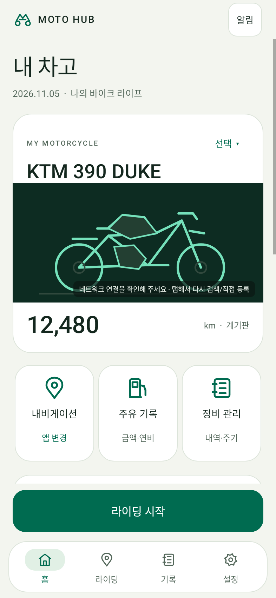 | 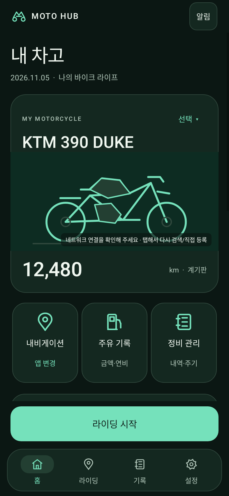 |
| 라이딩 | 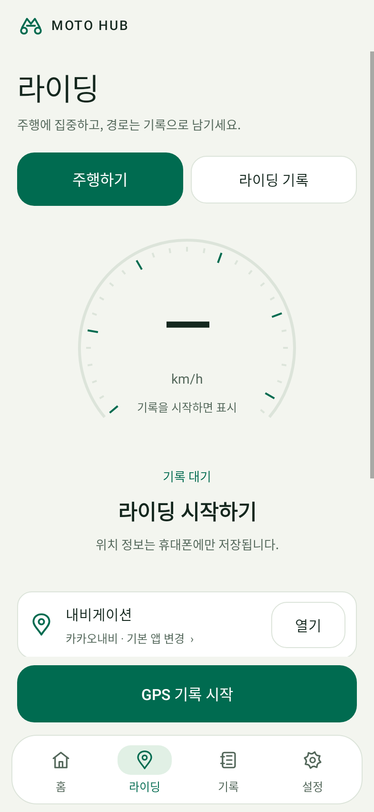 | 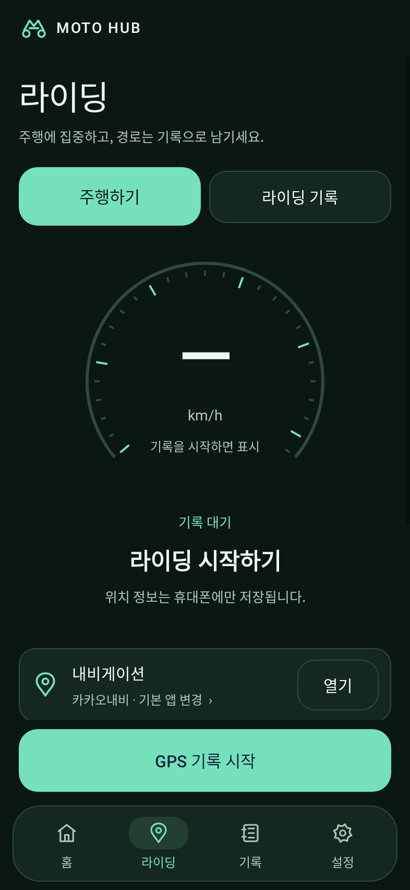 |
| 정비 · 주유 |  | 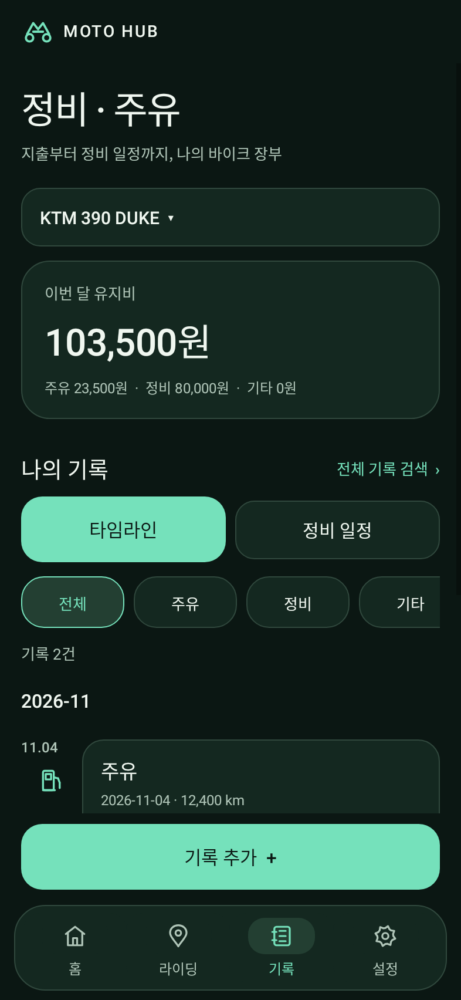 |
| 설정 | 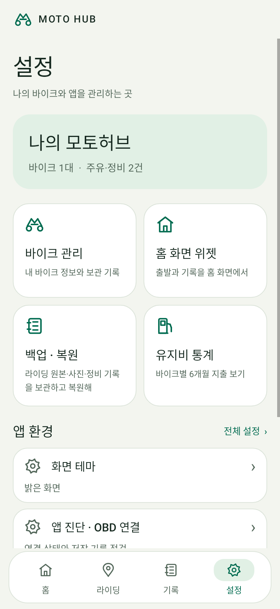 | 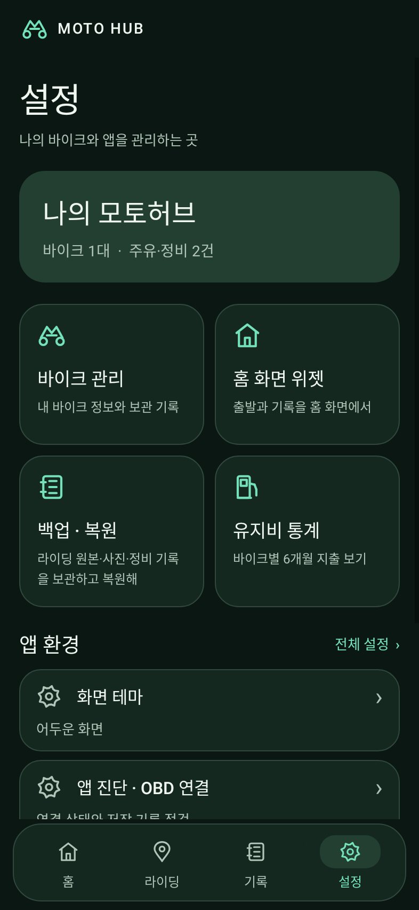 |

## 위젯과 아이콘

차량/내비 정보와 출발 버튼을 좌우로 나눈 대시보드(4×2), 두 동작을 세로로 배치한 바로가기 패드(2×2)로 다시 구성했습니다. 기존 작은 크기에서는 가로형 2×1로 축소됩니다. 큰 글씨에서는 문구를 우선 표시하고 주행 시작 동의와 내비만 실행을 구분합니다.

| 대시보드 · 라이트 | 대시보드 · 다크 |
| --- | --- |
| 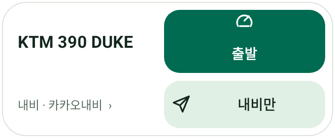 | 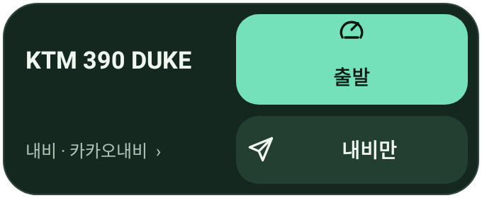 |

| 세로 바로가기 패드 | 다크 | 축소 배치 | 글씨 2배 |
| --- | --- | --- | --- |
| 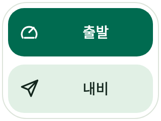 | 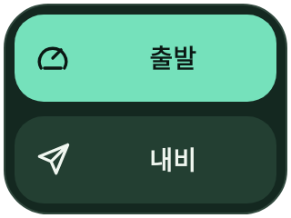 | 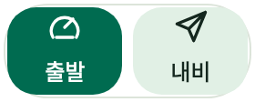 |  |

M 모양과 바이크 바퀴를 결합한 새 앱 아이콘입니다. Android 13 이상 테마 아이콘용 단색 레이어와 알림 아이콘도 포함합니다.

## 작은 화면과 검증

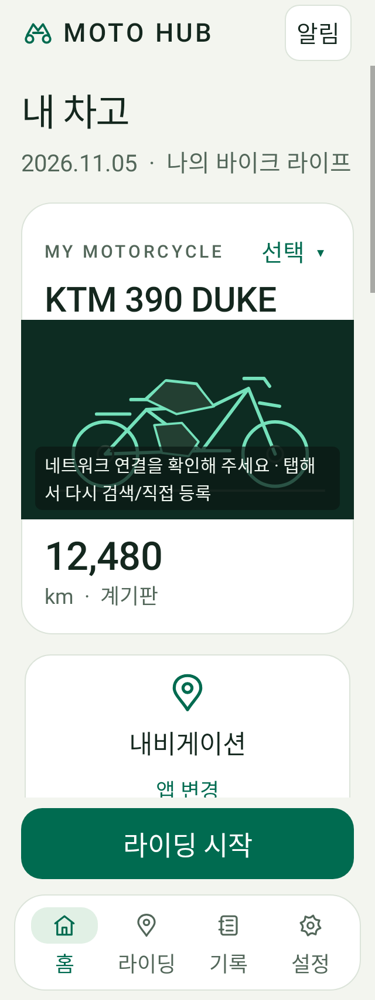 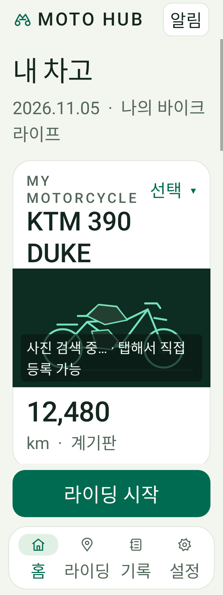

- APK 빌드·Android Lint·전체 단위 테스트 성공. 90 suites, 총 284개 중 통과 281개 / 건너뜀 3개 / 실패·오류 0개.
- Android Lint 오류 0개, 경고 85개. 기존 회귀 스크립트 176개 및 UI 정적 조건 48개 통과.
- 앱 320/393dp·라이트/다크·큰 글씨와 데이터 유지, 고정 버튼, 주행/기록 전환, 타임라인/정비 일정/입력 분리, 세부 설정 뒤로가기 검사. 위젯 최소 크기·글씨 1.3/1.5/2배, 터치 영역, 명암 대비, 주행/내비 분리, 개별 위젯 선택, DB 비접근 검사 통과.
- 이미지는 가상 테스트 데이터의 Android 네이티브 렌더링입니다. 실제 기기 GPS·런처·설치 업데이트 검증은 별도로 필요합니다.
- package `com.motohub.next`, debug versionCode `518`.
- SHA256 `60d4fa54a6e1ef06a9b55f3b7fe80cc0b9810d1c8d44f591e060b347fd3bd437`

소스: `8ec2c8057f3aafb922467f8d8c131527071d6689`
