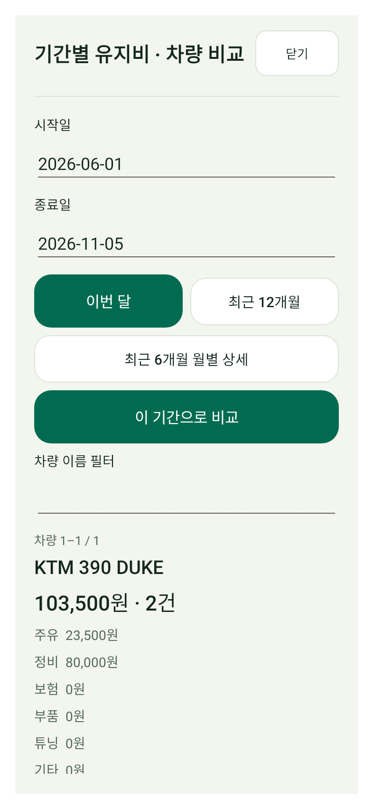
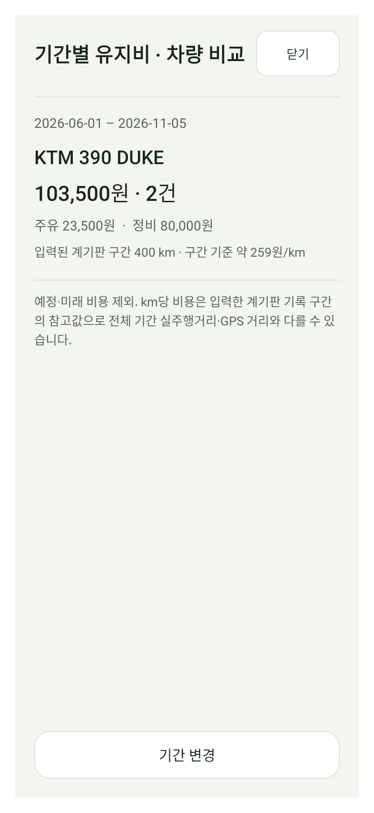
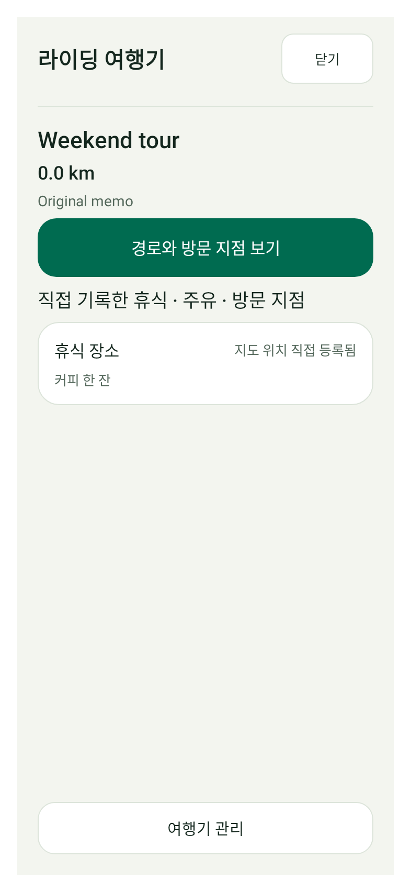
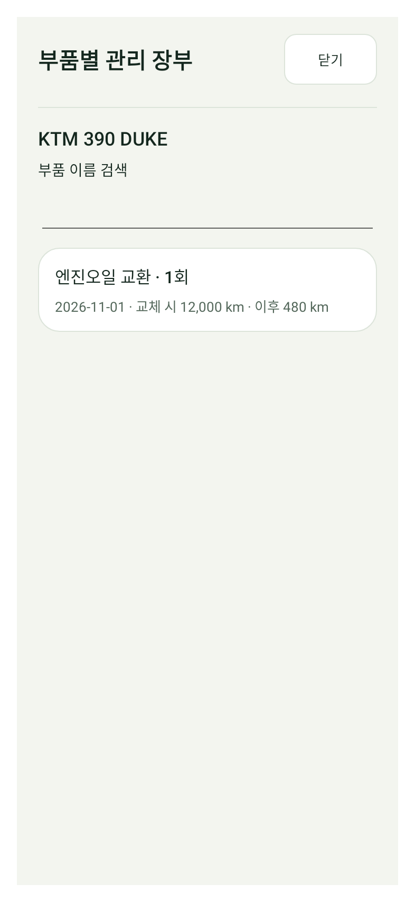
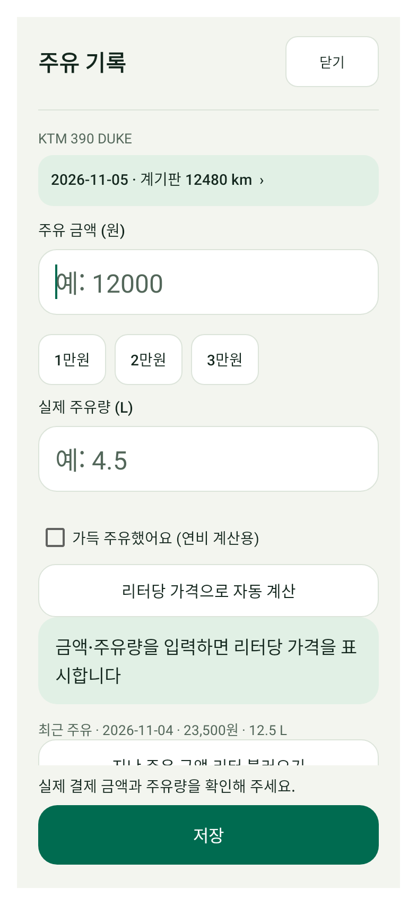
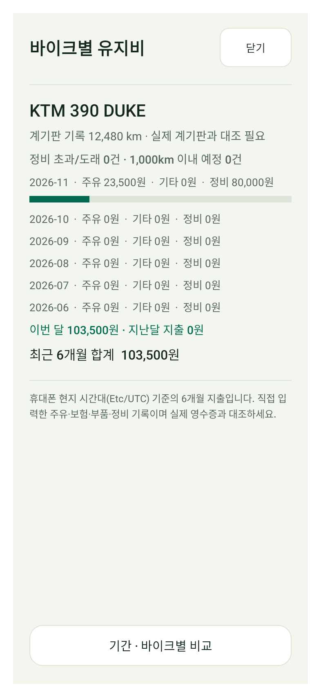

# MOTO HUB 최근 추가 화면의 버튼 과밀 정리

사용자가 이전 기능 미리보기의 UI를 거절해 최근 화면 변경을 정리했습니다. **BIFIX 전면 개편 완료본은 아닙니다.** 공식 사이트/Play 접근이 클라우드 프록시에서 차단되고 실제 BIFIX 화면이 없어, 새로운 브랜드 디자인을 추정하지 않았습니다. 기존 MOTO 컴포넌트로 최근 추가 화면의 과밀을 줄인 변경입니다.

[검토용 디버그 APK](MOTO-HUB-bee27de-UI-CLEANUP-DEBUG-TEST.apk?raw=true) · [소스](https://github.com/mercurial0416-lgtm/moto/commit/bee27de4b1ed956c15147666d5de48a8ca34942a)

**기존 정식 앱 업데이트용이 아닙니다. 기존 앱을 삭제하지 마세요.**

## 유지비

기본 진입은 이전 6개월 요약으로 복구하고 기간별 비교는 하단에서 엽니다. 비교 화면은 날짜 입력/프리셋/적용 버튼을 별도 기간 선택 창으로 옮겨 결과가 먼저 보입니다. 단일 바이크의 불필요한 검색란과 0원 범주 반복을 제거했습니다. 여러 바이크 검색·20대 페이지 이동은 유지했습니다.

| 기간 비교 변경 전 | 기간 비교 변경 후 |
| --- | --- |
|  |  |

## 여행기

제목/메모·사진·지도 지점 추가를 관리 메뉴로 옮겼습니다. 경로와 등록 지점이 먼저 보입니다. 지점마다 노출하던 삭제 버튼은 상세 메뉴로 옮겼고 메모 전문을 읽거나 경로를 열 수 있습니다. 삭제는 별도 확인 후 실행하며 취소 시 기록을 변경하지 않습니다.

| 변경 전 | 변경 후 |
| --- | --- |
|  |  |

## 부품 장부·주유·복구

부품 이력/복구 지점은 큰 버튼 대신 기존 기록 행으로 표시합니다. 주유 OCR은 '추가 입력 · 날짜·거리·영수증'으로 이동해 금액 입력을 밀어내지 않습니다. 복구센터의 ZIP/암호화 이전 도구 네 개는 메뉴로 묶었습니다. 기능과 데이터는 유지했습니다.

| 부품 장부 변경 전 | 변경 후 |
| --- | --- |
|  |  |

| 주유 기본 입력 | 유지비 기본 화면 복구 |
| --- | --- |
|  |  |

이미지는 가상 데이터의 Android 네이티브 렌더입니다. 아름다움이나 BIFIX 일치성을 테스트 통과로 판정하지 않습니다. 실제 BIFIX와 비교한 렌더 및 실기기 검증은 아닙니다.

## 검증

- assembleDebug / lintDebug / testDebugUnitTest 성공. 95 suites, 총 328개 중 통과 325·건너뜀 3·실패/오류 0.
- Lint 오류 0·경고 91. 기존 회귀 스크립트 176개 최신 결과 통과.
- 새 네이티브 검사: 유지비 기본 진입→기간 선택/역전 거부/재계산과 DB 무변경, 여행기 관리→지도 선택 및 지점 삭제 취소/GPS 바이트 동일, 추가 입력→영수증 선택 request 94/ZIP 도구 네 개 보존.
- 실제 사진 OCR 인식·지도 제스처·GPS/OBD 기기·TalkBack·기존 설치본 업데이트는 미검증입니다.
- 패키지 `com.motohub.next`, debug versionCode `518`. 패키지명·서명 설정·v3 저장 형식·업데이트 매니페스트를 바꾸지 않았습니다. 디버그 인증서는 이전 미리보기와 같으며 정식 설치본 인증서 일치를 뜻하지 않습니다.
- APK 49,337,422 bytes / SHA256 `115863864e332a217b81751d1885c82f81f3b15bde938a4a5b7e5ae5745b85b4`.
- 소스 `bee27de4b1ed956c15147666d5de48a8ca34942a`.
