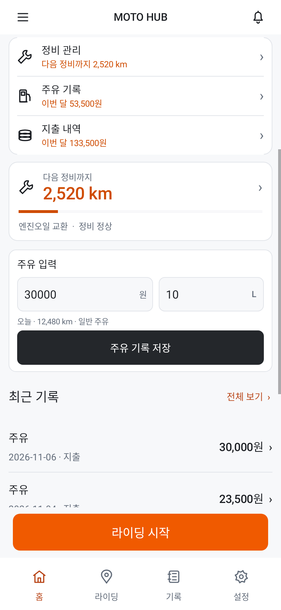

# MOTO HUB 02·07·03 구현

시안 02의 세 줄 관리 메뉴, 07의 바이크 이미지·이미지 위 차량 정보, 03의 정비 진행 표시와 홈 주유 입력을 적용했습니다.

## 실제 Android 렌더
| 홈 | 홈 아래 주유 입력 |
|---|---|
|  |  |

[홈 이미지 원본](home-light.png?raw=true) · [주유 입력 원본](fuel-light.png?raw=true) · [다크 홈](home-dark.png?raw=true) · [큰 글씨](home-large-text.png?raw=true)

주유 금액·리터를 홈에서 입력하고 저장합니다. 오늘 날짜·현재 계기판·일반 주유 기준을 화면에 표시합니다. 날짜·거리·가득 주유 등 추가 입력은 기존 주유 기록 메뉴에서 가능합니다. 잘못된 값은 저장하지 않으며 동일·유사 기록과 이상값은 기존 확인 절차를 거칩니다. 저장한 기록은 최근 기록과 월 지출에 반영됩니다. 홈 입력은 상세 주유 초안과 별도로 보존합니다.

바이크 이미지는 선택한 시안의 구도로 생성한 **모델 참고 일러스트**입니다. KTM 390 DUKE에만 적용하고 사용자 등록 사진이 있으면 그 사진을 우선합니다. 사용자의 실제 차량을 촬영한 사진이 아닙니다. 화면 수치는 테스트 데이터입니다.

## 원본 시안

## 검증
Debug 빌드 성공. DashboardDesignTest 4개, FuelConvenienceTest 6개, MajorFeatureUiTest 14개, UX87FuelDraftDurabilityTest 2개: 총 26개 통과.

홈 저장·잘못된 값 거부·중복 확인·상세 주유 초안 보존·기존 주유 입력 회귀를 확인했습니다. 화면은 Robolectric 네이티브 렌더이며 실기기 캡처가 아닙니다. 실기기 설치와 GPS/OBD 실통신은 미검증입니다.

[APK 다운로드](moto-273-debug.apk?raw=true) · [디자인 지침](UI_DESIGN_SPEC.md)

디버그 APK입니다. 정식 배포 서명과 업데이트 호환성은 보장하지 않습니다. 설치 충돌 시 기존 앱을 삭제하지 마세요.

SHA-256: `735f2afe7bd8ab225d76e422a83a7e554164e844f6c6e3d9ce7d22289e825840`
