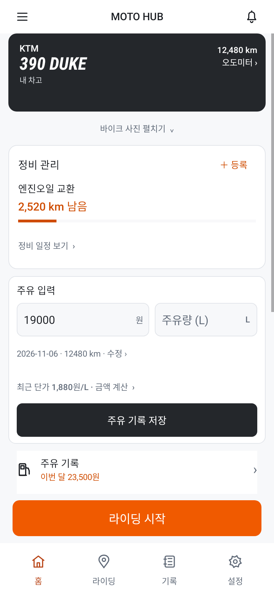

# MOTO HUB 일상 사용 개선

- 중복 정비 요약을 한 영역으로 통합. 실제 정비 항목·남은 거리·예정일 표시, 등록과 전체 일정 연결.
- 주유 입력을 정비 바로 아래로 이동. 최근 단가를 눌러 금액 계산, 날짜와 계기판을 펼쳐 수정, 저장 성공 알림.
- 최근 기록은 최대 다섯 건, 행 간격 축소와 정렬 개선. 큰 글씨는 세로 배치.
- 바이크 사진 접기/펼치기. 차량별 선택 상태와 입력값 보존.
- 기존 주유 중복·이상값 확인과 데이터 저장 검증 유지. 상세 주유 초안 보존.

## 실제 앱 렌더
| 사진을 펼친 홈 | 사진을 접은 홈 |
|---|---|
|  |  |

[주유·기록 화면](fuel-light.png?raw=true) · [다크 모드](collapsed-dark.png?raw=true) · [큰 글씨](large-text.png?raw=true)

모델 참고 일러스트와 테스트 수치를 사용하는 Robolectric 네이티브 렌더입니다. 실기기 캡처는 아닙니다.

## 검증
빌드 성공. 홈/주유/주요 화면/주유 초안 회귀 테스트 총 28개 통과. 최근 단가 계산, 수정한 날짜·계기판 저장, 사진 상태·입력 보존을 추가로 검증했습니다. 실기기 및 GPS/OBD 실통신은 미검증입니다.

[APK 다운로드](moto-daily-debug.apk?raw=true) · [디자인 지침](UI_DESIGN_SPEC.md)

디버그 APK입니다. 정식 앱의 서명 호환성은 확인되지 않았습니다. 설치 충돌 시 기존 앱을 삭제하지 마세요.

SHA-256: `b52e634db2b4375ef9922ac0912d989690edd3d04751fa52699815616f154bb4`
