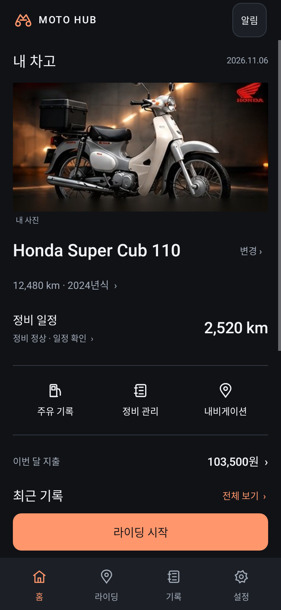
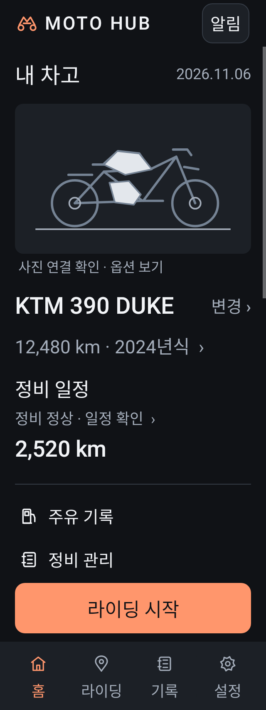

# MOTO HUB — 선택한 홈 구현

02 차고 구성 + 07 사진 표현 + 03 정비 동선을 실제 Android 홈에 적용했습니다.

사진 → 차종/계기판 → 정비 일정 → 주유·정비·내비 바로가기 → 월 지출·최근 기록. 라이딩 시작은 하단에 고정했습니다.

## 실행 화면
Robolectric 네이티브 렌더입니다. 실기기 캡처가 아닙니다. Honda 사진은 기존 번들 이미지로 만든 테스트용 등록 사진이며 차량과 수치도 테스트 데이터입니다.

사진 연결 실패 상태 / 320dp · 큰 글씨:

## 빌드와 검증
- Debug APK 빌드 성공.
- DashboardDesignTest 3개 통과, 실패 0. 화면 렌더, 기록 불변, 주유 입력 진입 확인.
- 실기기 설치, GPS/OBD 실통신, 정식 배포 서명 호환성 미검증.
- 이번 범위는 홈과 디자인 지침. 다른 화면의 전면 개편은 후속 작업입니다.

[APK 다운로드](moto-home-debug.apk?raw=true) · [디자인 지침](UI_DESIGN_SPEC.md)

디버그 APK이므로 기존 정식 앱에 업데이트 설치가 보장되지 않습니다. 기존 데이터를 보존하려면 설치 충돌 시 기존 앱을 삭제하지 마세요.

APK SHA-256: `1b33622ecb1b795de6c5ceb5f749914c90f8bfd9c8b6b7333b81bc9d41a187e4`
