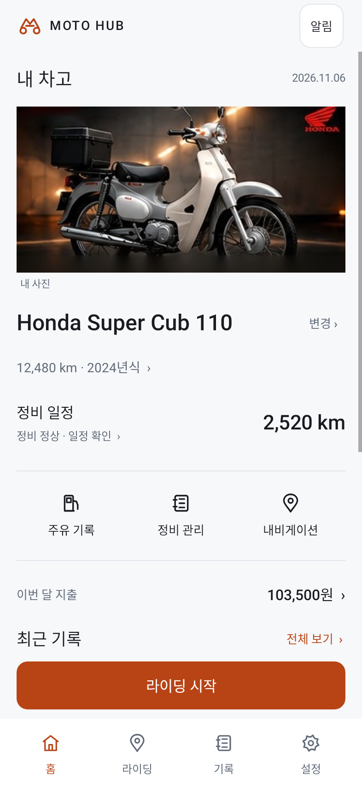

# 02·07·03 시안 대조 후 수정한 홈

이전 구현의 별도 큰 제목·날짜·가로 아이콘 배치를 제거했습니다.

- 02: 중앙 헤더, 사진 아래 정비·주유·지출 세 행.
- 07: 사진 내부의 차명·오도미터와 304dp 대표 사진 영역.
- 03: 실제 다음 정비 거리, 정비주기 진행률, 관리 화면 직접 진입.
- 하단 라이딩 실행과 기존 네 탭은 유지했습니다.

## 수정 전 / 수정 후
| 이전 구현 | 이번 수정 |
|---|---|
|  |  |

[수정 화면 원본](home-light.png?raw=true) · [다크 화면](home-dark.png?raw=true) · [큰 글씨 화면](home-large-text.png?raw=true)

## 선택한 원본 시안

## 확인 범위
실제 Android 코드의 Robolectric 네이티브 렌더입니다. 실기기 캡처가 아닙니다. Honda 사진과 수치는 테스트용입니다. 시안의 KTM 실사 원본 자산은 제공되지 않아 같은 사진을 앱에 넣지는 않았습니다. 등록 사진 또는 확인된 모델 사진을 사용하며 사진이 없는 상태도 검증했습니다. 03의 인라인 주유 폼 전체를 옮긴 것은 아니며 기존 주유 입력 화면에 직접 연결합니다.

Debug 빌드 성공, DashboardDesignTest 3개 통과. 데이터 불변, 주유 입력 진입, 사진/차량 정보 배치 확인. 실기기와 GPS/OBD 실통신은 미검증입니다.

[수정 APK 다운로드](moto-home-corrected-debug.apk?raw=true) · [디자인 지침](UI_DESIGN_SPEC.md)

디버그 서명입니다. 정식 앱에 업데이트 설치가 보장되지 않으므로 충돌 시 기존 앱을 삭제하지 마세요.

SHA-256: `b8cd936a61b687327358d9631083dc69c5ab8bc955617d3c843063f1d36e658c`
