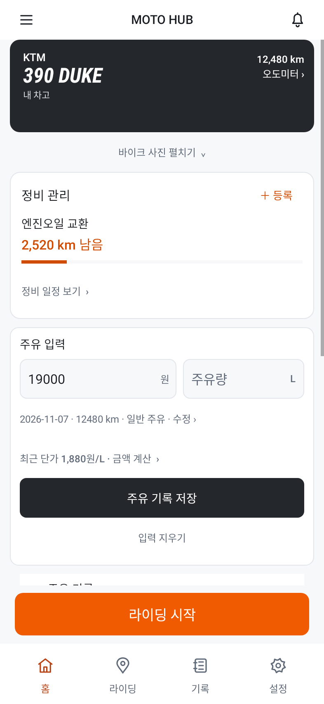
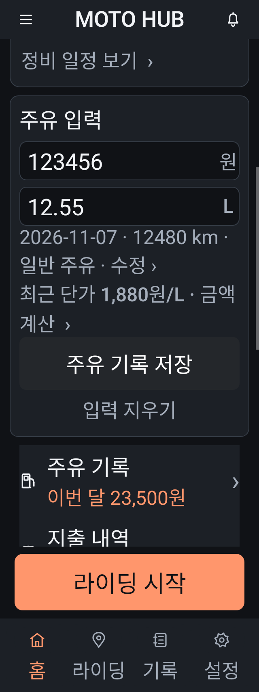

# MOTO HUB 안정성 개선

- 홈 주유 첫 편집부터 날짜·계기판 함께 보존.
- 예정·미래·잘못된 날짜 기록은 최근 단가에서 제외.
- 확인 후 홈 입력만 지우기. 저장 기록과 상세 초안 보존.
- 사진을 접은 상태의 긴 차량명/큰 글씨 잘림 수정.
- 큰 글씨·좁은 화면에서 금액·리터 세로 배치.
- 정비 등록 숨김과 실제 적용 가능한 설정 일치. 기존 설정값 유지.
- 홈 링크 접근성 설명 보완.
- 홈 초안을 설정 포함 전체 ZIP에 보관. 로컬 입력 우선·바이크 연결·크기 제한·실패 시 복구.

## 실제 렌더

Robolectric 네이티브 렌더이며 테스트 데이터/모델 참고 일러스트입니다. 실제 기기 캡처는 아닙니다.

## 검증과 재개
전체 339개 중 336개 통과 / 3개 건너뜀 / 실패 0. Lint 오류 0 / 경고 96. Debug 빌드 성공. 실기기 설치·GPS/OBD·정식 서명은 미검증입니다.

재개 내용과 다음 점검은 작업 공간의 `docs/CONTINUE_HERE.md`에 기록하고 별도 로컬 Git 체크포인트에 보존했습니다. 같은 대화에서 “이어서 해”로 재개할 수 있습니다. 토큰 리필만으로 자동 실행되지는 않습니다. 이 결과물 브랜치에는 소스를 게시하지 않았습니다.

[최신 APK 다운로드](moto-reliability-debug.apk?raw=true) · [검증 수치](checks.json)

디버그 APK입니다. 설치 충돌 시 기존 앱을 삭제하지 마세요.

SHA-256: `207da6ffb00dc15c27029216f8a9852bd4c15b49ae198f3de7417939044c6704`
