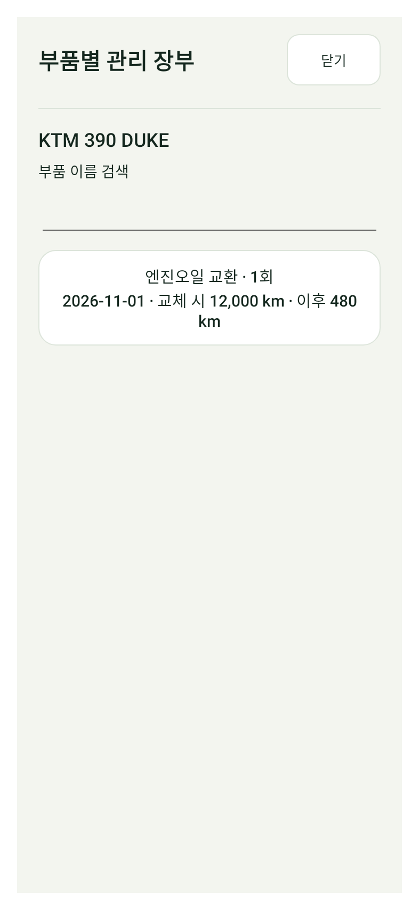
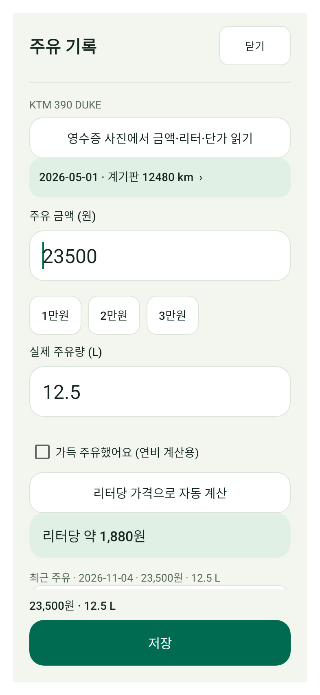
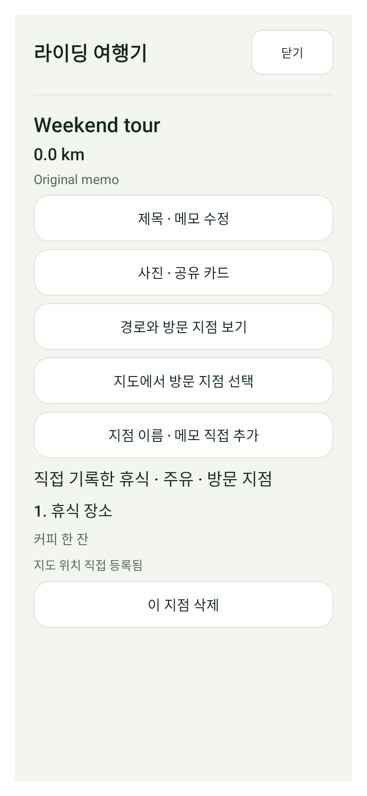

# MOTO HUB 기능 개선 미리보기 — BIFIX 전면 개편 미완료

**이 APK는 BIFIX UI 개편 완료본이 아닙니다.** 공식 사이트와 Play가 현재 클라우드 프록시에서 HTTP 403으로 차단되고 BIFIX 화면 첨부가 없어 실제 레이아웃을 확인하지 못했습니다. 임의로 디자인을 추정하지 않았으며 아래 새 기능 화면은 기존 MOTO HUB UI를 임시 사용합니다. BIFIX 로고·이미지·브랜드 자산을 복제하지 않았습니다.

[기능 미리보기 APK 다운로드](MOTO-HUB-e71a430-FEATURES-PREVIEW-DEBUG-TEST.apk?raw=true) · [소스 커밋](https://github.com/mercurial0416-lgtm/moto/commit/e71a4307f30129e3e25e75721d2305f54127676c) · [전체 화면 조사 및 레퍼런스 상태](https://github.com/mercurial0416-lgtm/moto/blob/e71a4307f30129e3e25e75721d2305f54127676c/MOTO-HUB/docs/BIFIX_REFERENCE_STATUS.md)

**디버그 테스트용입니다. 기존 정식 앱 업데이트용이 아니므로 기존 앱을 삭제하지 마세요.** 테스트 기기에서 검토하세요. 정식 릴리스와 앱 내 업데이트 매니페스트는 변경하지 않았습니다.

## 실제 구현한 기능

- **부품 장부:** 내 바이크 관리와 기록 도구에서 정비 항목별 이력·마지막 교체 후 사용 거리·제품명/규격/정비소/메모를 확인하고 편집합니다. 기존 사진/영수증 기능과 연결합니다. 예정/미래 기록을 완료 이력에서 제외합니다.
- **기간별 비용 비교:** 유지비 화면에서 날짜 범위와 차량 이름으로 비교합니다. 주유·정비·보험·부품·튜닝·기타, 20대씩 목록 이동, 기존 6개월 월별 상세를 제공합니다. km당 비용은 입력한 계기판 기록 구간의 참고값입니다. 거리 부족/역전에서는 표시하지 않습니다.
- **주유 영수증 확인:** 빠른 주유에서 이미지를 선택하고 금액·리터·날짜·표시된 단가 후보를 확인한 후 입력란에 적용합니다. 별도로 저장해야 기록됩니다. 취소/편집 변경/다른 바이크에는 이전 결과를 적용하지 않으며 계기판·가득 주유를 추측하지 않습니다.
- **라이딩 여행기:** 완료한 주행 상세에서 제목·메모, 기존 대표 사진/공유 카드, 경로, 직접 입력/지도 선택한 휴식·주유·방문 지점을 연결합니다. 자동 휴식 탐지나 여러 사진 앨범은 추가하지 않았습니다. 원본 GPS 파일은 수정하지 않습니다.
- **기기 이전·복구센터:** 백업에서 기존 전체 ZIP/암호화 이전, 자동 복구 지점, 알려진 컬렉션/설정별 추가·삭제·변경 개수를 검토하고 두 번째 확인 후 복원합니다. **로컬 복구 지점은 JSON만 포함하며 GPS/사진 이전에는 전체 ZIP이 필요합니다.**

## 기능 화면 (BIFIX 참조 렌더 아님)

| 부품 장부 | 기간별 비용 |
| --- | --- |
|  |  |

| 영수증 확인 후 입력 | 여행기·직접 등록 지점 |
| --- | --- |
|  |  |

이미지는 가상 데이터를 사용한 Android 네이티브 렌더(393×852dp/xhdpi)입니다. 실제 BIFIX와 비교한 화면이나 실제 단말 검증을 뜻하지 않습니다.

## 검증과 한계

- assembleDebug / lintDebug / testDebugUnitTest 성공. 95 suites / 총 325개 중 통과 322·건너뜀 3·실패/오류 0.
- Lint 오류 0·경고 90. 기존 shell 회귀 176개 최신 결과 통과. 신규 모델·저장·네이티브 UI 검사 29개 포함.
- 기존 v3 데이터 왕복 보존, GPS 바이트 동일, 부품 편집 시 거래 값 보존, 원자 저장/복구 체크포인트, 확인 전 DB 무변경, 편집 중 변경 거부, 영수증 확인/취소, 비용 목록 페이지 이동을 검증했습니다.
- 실제 사진의 MLKit OCR 인식, 지도 길게 누르기 제스처, GPS/OBD 실기기·백그라운드, 키보드/TalkBack, 이전 설치본 업데이트는 미검증입니다. 패키지·서명 설정·데이터 스키마는 유지했습니다.
- package `com.motohub.next`, debug versionCode `518`. 이전 미리보기와 같은 디버그 인증서이며 정식 설치본 인증서 일치를 뜻하지 않습니다.
- APK 49,336,311 bytes / SHA256 `e9d707d08f02add68072548625a9b3af351bfe8a01d76c713a92029026a77f9e`.
- 소스 `e71a4307f30129e3e25e75721d2305f54127676c`.

BIFIX 실화면 자료가 확보되면 홈부터 모든 하위 화면까지 실제 패턴을 대응하고 렌더를 비교해야 합니다. 현재 허용 도메인은 환경 초안에 저장했지만 런타임 적용/환경 게시가 완료된 것은 아닙니다.
